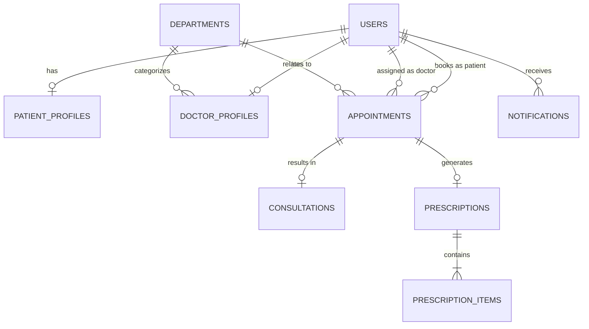

# HEALTH & CARE — RELATIONAL DATABASE DESIGN

## Database Architecture Overview
The Health & Care primary platform uses a relational architecture executed via **Spring JDBC** (`JdbcTemplate`, `NamedParameterJdbcTemplate`, `PreparedStatement`, `RowMapper`).

In accordance with strict academic guidelines:
- **No JPA, Hibernate, or ORM** is utilized.
- All relationships and constraints are enforced directly in PostgreSQL / H2 DDL.
- Parameterized SQL is used across all repositories to prevent SQL injection.

---

## Entity-Relationship Schema

---

## Table Definitions

### 1. `users`
- `id`: `SERIAL PRIMARY KEY`
- `email`: `VARCHAR(255) NOT NULL UNIQUE`
- `password_hash`: `VARCHAR(255) NOT NULL` (BCrypt encoded)
- `full_name`: `VARCHAR(150) NOT NULL`
- `phone`: `VARCHAR(30) NOT NULL`
- `role`: `VARCHAR(30) NOT NULL` (`ROLE_PATIENT`, `ROLE_DOCTOR`, `ROLE_ADMIN`)
- `status`: `VARCHAR(30) NOT NULL DEFAULT 'ACTIVE'`
- `created_at`: `TIMESTAMP DEFAULT CURRENT_TIMESTAMP`

### 2. `patient_profiles`
- `id`: `SERIAL PRIMARY KEY`
- `user_id`: `INT NOT NULL UNIQUE REFERENCES users(id) ON DELETE CASCADE`
- `date_of_birth`: `DATE`
- `gender`: `VARCHAR(20)`
- `blood_group`: `VARCHAR(10)`
- `address`: `TEXT`
- `emergency_contact`: `VARCHAR(50)`

### 3. `doctor_profiles`
- `id`: `SERIAL PRIMARY KEY`
- `user_id`: `INT NOT NULL UNIQUE REFERENCES users(id) ON DELETE CASCADE`
- `department_id`: `INT REFERENCES departments(id) ON DELETE SET NULL`
- `qualification`: `VARCHAR(255) NOT NULL`
- `specialization`: `VARCHAR(150) NOT NULL`
- `experience_years`: `INT NOT NULL DEFAULT 1`
- `medical_registration_no`: `VARCHAR(100) NOT NULL UNIQUE`
- `consultation_fee`: `NUMERIC(10, 2) DEFAULT 500.00`
- `bio`: `TEXT`
- `verification_status`: `VARCHAR(30) DEFAULT 'PENDING'` (`PENDING`, `APPROVED`, `REJECTED`)
- `available_days`: `VARCHAR(100)`
- `working_hours`: `VARCHAR(100)`

### 4. `departments`
- `id`: `SERIAL PRIMARY KEY`
- `name`: `VARCHAR(100) NOT NULL UNIQUE`
- `description`: `TEXT`
- `icon_name`: `VARCHAR(50)`
- `is_active`: `BOOLEAN DEFAULT TRUE`

### 5. `appointments`
- `id`: `SERIAL PRIMARY KEY`
- `patient_id`: `INT NOT NULL REFERENCES users(id) ON DELETE CASCADE`
- `doctor_id`: `INT NOT NULL REFERENCES users(id) ON DELETE CASCADE`
- `department_id`: `INT REFERENCES departments(id) ON DELETE SET NULL`
- `appointment_date`: `DATE NOT NULL`
- `appointment_time`: `VARCHAR(20) NOT NULL`
- `status`: `VARCHAR(30) NOT NULL DEFAULT 'PENDING'` (`PENDING`, `CONFIRMED`, `REJECTED`, `COMPLETED`, `CANCELLED`)
- `reason`: `TEXT`
- `notes`: `TEXT`
- `created_at`: `TIMESTAMP DEFAULT CURRENT_TIMESTAMP`
- `updated_at`: `TIMESTAMP DEFAULT CURRENT_TIMESTAMP`

### 6. `consultations`
- `id`: `SERIAL PRIMARY KEY`
- `appointment_id`: `INT NOT NULL UNIQUE REFERENCES appointments(id) ON DELETE CASCADE`
- `patient_id`: `INT NOT NULL REFERENCES users(id) ON DELETE CASCADE`
- `doctor_id`: `INT NOT NULL REFERENCES users(id) ON DELETE CASCADE`
- `diagnosis`: `TEXT NOT NULL`
- `symptoms`: `TEXT`
- `clinical_notes`: `TEXT`
- `treatment_plan`: `TEXT`

### 7. `prescriptions`
- `id`: `SERIAL PRIMARY KEY`
- `consultation_id`: `INT REFERENCES consultations(id) ON DELETE SET NULL`
- `appointment_id`: `INT NOT NULL REFERENCES appointments(id) ON DELETE CASCADE`
- `patient_id`: `INT NOT NULL REFERENCES users(id) ON DELETE CASCADE`
- `doctor_id`: `INT NOT NULL REFERENCES users(id) ON DELETE CASCADE`
- `diagnosis`: `TEXT NOT NULL`
- `general_instructions`: `TEXT`
- `issued_date`: `DATE DEFAULT CURRENT_DATE`

### 8. `prescription_items`
- `id`: `SERIAL PRIMARY KEY`
- `prescription_id`: `INT NOT NULL REFERENCES prescriptions(id) ON DELETE CASCADE`
- `medicine_name`: `VARCHAR(150) NOT NULL`
- `dosage`: `VARCHAR(50) NOT NULL`
- `frequency`: `VARCHAR(50) NOT NULL`
- `duration`: `VARCHAR(50) NOT NULL`
- `instructions`: `VARCHAR(255)`

### 9. `notifications`
- `id`: `SERIAL PRIMARY KEY`
- `user_id`: `INT NOT NULL REFERENCES users(id) ON DELETE CASCADE`
- `title`: `VARCHAR(150) NOT NULL`
- `message`: `TEXT NOT NULL`
- `type`: `VARCHAR(50)`
- `is_read`: `BOOLEAN DEFAULT FALSE`
